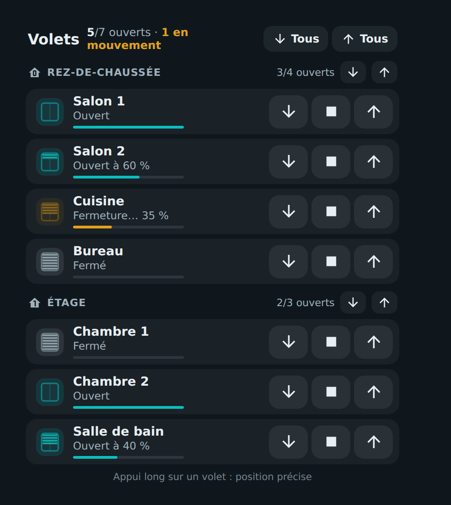
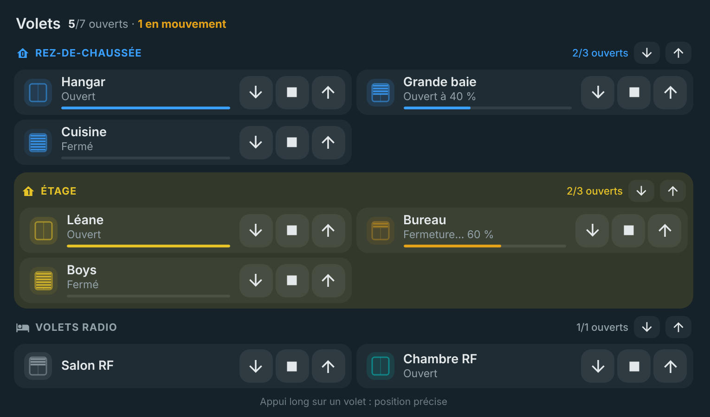
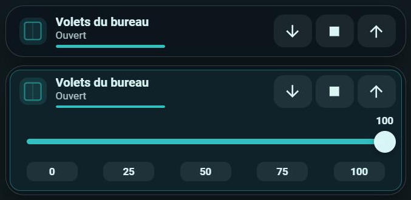
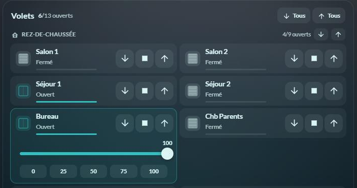

# 🪟 HOLM Covers Card

[](https://hacs.xyz/)


[🇫🇷 Français](README.md) · 🇬🇧 English

**All your shutters on one card, sorted by floor: one glance to see what is open, one tap to control everything.**

HOLM Covers Card shows your roller shutters in a **compact, horizontal** layout, grouped by floor (or by area), or **a single shutter** wherever you need it. Each row has its ▼ ■ ▲ buttons, its position in plain words (“Open at 60 %”, “Closing… 35 %”) and a small window whose slats move down with the shutter.

> ✨ **Zero YAML.** Groups and shutters are set up in the visual editor.

### At a glance

- 🧭 **Summary**: “5/7 open · 1 moving”, for the whole home and per floor.
- ⏬ **Group commands**: open / close everything per floor, and for the whole home with the `all` option.
- 🪟 **Single shutter**: a one-row card for one shutter, with no title or group.
- 👆 **Short press** on a shutter: opens, closes or stops it if moving — or shows the slider, opens the more-info dialog, or does nothing (your choice). Scrolling the page no longer triggers anything.
- 🎚️ **Long press**: precise position slider and 0 / 25 / 50 / 75 / 100 shortcuts, right inside the shutter's tile.
- 🟧 Amber while moving, turquoise when open, position gauge under each shutter (full width).
- 🎨 **One colour per group** (icons and title), optional tinted background, colour per shutter.
- 📡 **Shutters without state feedback**: state hidden, or taken from an opening sensor.
- 🛑 **Most closed position**: a shutter that must not go below 40 % stops at 40 % when you “close” it.
- 🌍 **8 languages**: French, English, German, Spanish, Italian, Dutch, Portuguese and Polish.



### 🆕 What's new in 1.4.0

- 🛑 **Most closed position** (`min_position`, thanks to developpeurbox for the idea and his code proposal): for a shutter that must not go below a given position. With `min_position: 40`, the ▼ button, “Close all”, “All” and the short press stop at 40 % instead of closing fully; the slider and shortcuts do not go below it (hatched area, greyed shortcuts). A shutter at its most closed position shows “Closed” and no longer counts as open. Set on the card, a group or a shutter (the most specific wins), in the editor. See [Most closed position](#most-closed-position).
- 🔢 **Hide the counters** (`show_counts: false`): the “3/7 open” counters in the header and groups disappear, for instance when the shutters' state is meaningless for you. “Moving” stays shown.
- The loaded version is shown in the browser console.

### What's new in 1.3.0

- 🌍 **8 languages**: the card and its editor speak French, English, German, Spanish, Italian, Dutch, Portuguese and Polish. They follow your Home Assistant profile language (English if your language is not translated); the `language` option forces one.

### What's new in 1.2.0

- 🎨 **One colour per group**: icons and title in the group's colour, with an optional **tinted background** (adjustable opacity). A colour can also be given to a single shutter.
- 📡 **Shutters without state feedback** (radio…): hide “Open / Closed” and the position (`show_state: false`), or show the state from an **opening sensor** (`state_entity`, a `binary_sensor`), shutter by shutter.
- 👆 **Short press of your choice** (`tap_action`): open / close, position slider, more-info dialog or nothing. A swipe (scrolling the page on mobile) is no longer taken as a press.
- 📏 The **position gauge** extends up to the buttons.

Everything is set in the editor, including **per-shutter settings** (short name, opening sensor, colour, state).



### What's new in 1.1.0

#### 🪟 A single shutter, without a group

The card can show **a single shutter**, with no title, group header or summary: just the shutter's row with its ▼ ■ ▲ buttons, position and gauge. Ideal to put a room's shutters on that room's view, next to its lights.

In the editor, choose **Display → Single shutter**, then the shutter and, if needed, a shorter name. The long press for the precise position works as in the full card. Switching back to **Shutter groups** puts the shutter in a first group.



#### 🎚️ The precise position stays in the shutter's tile

On a long press, the position slider opens **inside the shutter's tile**, without spreading over the whole card: on two columns, the neighbouring shutter does not move. The 0 / 25 / 50 / 75 / 100 shortcuts go under the slider when the tile is narrow, and beside it when it is wide.



---

## Installation

### With HACS (recommended)

1. HACS → ⋮ menu → **Custom repositories**.
2. Add `https://github.com/kaaribou/holm-covers-card`, category **Dashboard** (*Plugin*).
3. Search for the card → **Download**.
4. Reload the page (Ctrl + F5).

### Manually

1. Copy `dist/holm-covers-card.js` to `config/www/community/holm-covers-card/`.
2. **Settings → Dashboards → ⋮ → Resources → Add**: `/local/community/holm-covers-card/holm-covers-card.js`, type **JavaScript module**.
3. Reload the page.

---

## Usage

### Shutters by floor

```yaml
type: custom:holm-covers-card
title: Shutters
all: cover.all_shutters         # optional: “All” buttons
groups:
  - name: Ground floor
    icon: mdi:home-floor-0
    entities:
      - entity: cover.living_room
        name: Living room
      - cover.kitchen
  - name: First floor
    icon: mdi:home-floor-1
    entities: [cover.bedroom_1, cover.bedroom_2]
    color: "#e6c229"              # optional: group colour
    tint: true                    # optional: tinted background
  - name: Radio shutters
    entities:
      - entity: cover.living_room_rf
        show_state: false         # no known state: nothing is shown
      - entity: cover.bedroom_rf
        state_entity: binary_sensor.bedroom_window   # state from the sensor
```

### Most closed position

Some shutters must not go all the way down: an IKEA blind set to let light through, a shutter that hits an obstacle, a cat flap… With `min_position`, “close” means “go down to this position”:

```yaml
type: custom:holm-covers-card
min_position: 10                  # every shutter of the card stops at 10 %
groups:
  - name: First floor
    min_position: 20              # this group's shutters stop at 20 %
    entities:
      - cover.bedroom_1
      - entity: cover.skylight
        min_position: 40          # this shutter stops at 40 %
```

- **What stops at the set position**: a shutter's ▼ button, a group's “Close all”, “All” ▼ and the short press. With “All”, the other members of the `all` group that are not shown on the card close normally.
- **Slider and shortcuts**: they do not go below the set position; the forbidden part of the slider is hatched and the affected shortcuts are greyed out.
- **Display**: a shutter at (or below) its most closed position shows “Closed”, with a closed-shutter icon, and no longer counts as open.
- **Priority**: a shutter's setting wins over its group's, which wins over the card's. 0 = fully closed, as before.
- The limit only applies to the card: your automations and the shutter's more-info dialog can still close it fully.

### A single shutter

```yaml
type: custom:holm-covers-card
entity: cover.office
name: Office shutters           # optional
```

## Options

| Option | Description | Default |
|---|---|---|
| `entity` | **Single shutter**: the shutter to show (replaces `groups`) | — |
| `name` | Single shutter: displayed name | the shutter's name |
| `title` | Title (groups mode) | `Shutters` |
| `all` | Shutter (or shutter group) controlled by the “All” buttons (groups mode) | — |
| `groups` | Groups: `name`, `icon`, `entities` (entity or `{ entity, name }`) | — |
| `show_frame` | Show the card frame | `true` |
| `show_state` | Show the state (“Open / Closed”, position, gauge) | `true` |
| `tap_action` | Short press: `toggle` (open / close / stop), `position` (slider), `more-info` (dialog), `none` | `toggle` |
| `show_counts` | Show the “x/y open” counters (header and groups) | `true` |
| `min_position` | Most closed position (%) of every shutter on the card (see above) | `0` |
| `language` | Language: `fr`, `en`, `de`, `es`, `it`, `nl`, `pt`, `pl` | the profile's |
| Group: `color`, `tint`, `tint_opacity`, `min_position` | Group colour (icons, title), tinted background, background opacity (%), group's most closed position | —, `false`, `12`, — |
| Shutter: `name`, `color`, `state_entity`, `show_state`, `min_position` | Short name, colour, opening sensor giving the state, show this shutter's state or not, this shutter's most closed position | — |

You need either `entity` (single shutter) or `groups`. Without `all`, the header's “All” buttons are hidden; each floor's buttons remain.

## FAQ

| Problem | Solution |
|---|---|
| No slider on long press | The shutter does not support a position (only open / close). |
| My shutters do not report their state | `show_state: false` to show nothing, or `state_entity` (opening sensor) for each equipped shutter. |
| The short press triggers when I scroll the page | Fixed in 1.2.0; you can also choose **No action** (`tap_action: none`). |
| My shutter must not close fully | `min_position` (e.g. `40`) on the shutter, its group or the card. |
| I don't need the “open” counters | `show_counts: false`. |
| I want a single shutter without the card background | Untick **Show the card frame** (`show_frame: false`). |
| The new version doesn't show | Clear the cache (Ctrl + F5). |

---

## Say thanks?

Like the card? You can buy me a beer 🍺

[](https://paypal.me/kaaribou)

---

## License

Code: **MIT** licence — © kaaribou. See the [CHANGELOG](CHANGELOG.md).

Part of the **HOLM** collection: [Volets HOLM](https://github.com/kaaribou/volets-holm) · [Climat HOLM](https://github.com/kaaribou/climat-holm) · [Carburant HOLM](https://github.com/kaaribou/carburant-holm) · [Commandes à la maison HOLM](https://github.com/kaaribou/commandes-holm) · [HOLM Navbar Card](https://github.com/kaaribou/holm-navbar-card) · [HOLM Climate Card](https://github.com/kaaribou/climate-card-holm) · [HOLM Music Card](https://github.com/kaaribou/holm-music-card) · [HOLM Sentinel Card](https://github.com/kaaribou/holm-sentinel-card) · [HOLM Security Card](https://github.com/kaaribou/holm-security-card) · [HOLM Recordings Card](https://github.com/kaaribou/holm-recordings-card) · [HOLM Power Flow Card](https://github.com/kaaribou/holm-power-flow-card) · [HOLM Energy Cards](https://github.com/kaaribou/holm-energy-cards) · [HOLM Radiator Card](https://github.com/kaaribou/holm-radiator-card) · [HOLM Floor Card](https://github.com/kaaribou/holm-floor-card) · [HOLM Smoke Card](https://github.com/kaaribou/holm-smoke-card) · [HOLM BG Card](https://github.com/kaaribou/holm-bg-card).
