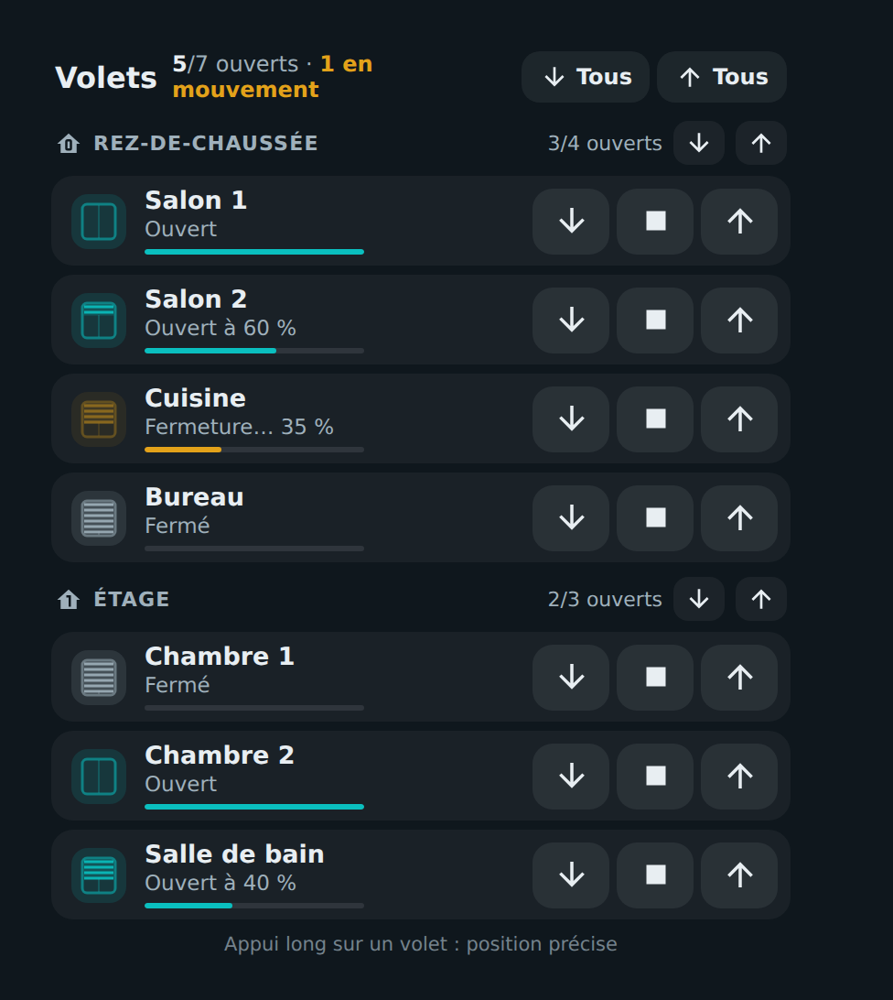
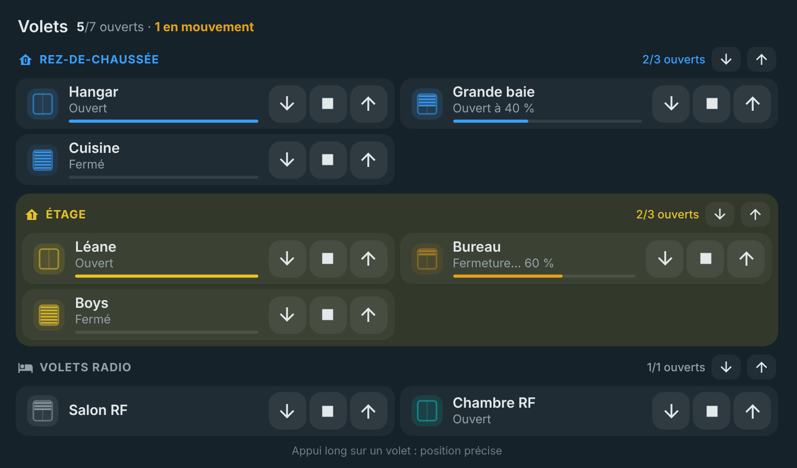
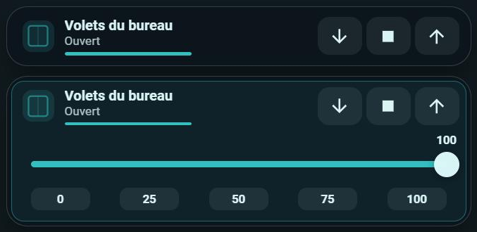
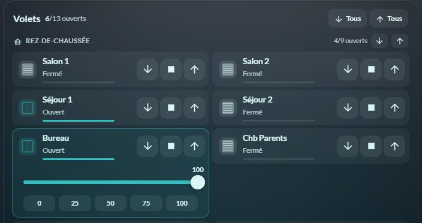

# 🪟 HOLM Covers Card

[](https://hacs.xyz/)


**Tous vos volets sur une seule carte, rangés par étage : un coup d'œil pour savoir ce qui est ouvert, un toucher pour tout commander.**

HOLM Covers Card affiche vos volets roulants de façon **compacte et horizontale**, regroupés par étage (ou par zone), ou **un volet seul** là où vous en avez besoin. Chaque ligne a ses boutons ▼ ■ ▲, sa position en clair (« Ouvert à 60 % », « Fermeture… 35 % ») et une petite fenêtre dont les lames descendent avec le volet.

> ✨ **Zéro YAML.** Groupes et volets se configurent dans l'éditeur visuel.

### En bref

- 🧭 **Résumé** : « 5/7 ouverts · 1 en mouvement », par maison et par étage.
- ⏬ **Commandes groupées** : tout ouvrir / tout fermer par étage, et pour toute la maison avec l'option `all`.
- 🪟 **Volet seul** : une carte d'une seule ligne pour un volet, sans titre ni groupe.
- 👆 **Appui court** sur un volet : ouvre, ferme ou stoppe s'il bouge — ou affiche le curseur, ouvre la fiche, ou ne fait rien (au choix). Faire défiler la page ne déclenche plus rien.
- 🎚️ **Appui long** : curseur de position précise et raccourcis 0 / 25 / 50 / 75 / 100, directement dans la tuile du volet.
- 🟧 Couleur ambre pendant le mouvement, turquoise quand c'est ouvert, jauge de position sous chaque volet (sur toute la largeur).
- 🎨 **Une couleur par groupe** (icônes et titre), fond teinté en option, couleur volet par volet.
- 📡 **Volets sans retour d'état** : état masqué, ou déduit d'un capteur d'ouverture.



### 🆕 Nouveautés de la 1.2.0

- 🎨 **Une couleur par groupe** : icônes et titre aux couleurs du groupe, avec un **fond teinté** en option (opacité réglable). Une couleur peut aussi être donnée à un volet précis.
- 📡 **Volets sans retour d'état** (radio…) : masquez « Ouvert / Fermé » et la position (`show_state: false`), ou affichez l'état d'après un **capteur d'ouverture** (`state_entity`, un `binary_sensor`) volet par volet.
- 👆 **Appui court au choix** (`tap_action`) : ouvrir / fermer, curseur de position, fiche du volet ou rien. Un toucher qui glisse (défilement de la page sur mobile) n'est plus pris pour un appui.
- 📏 La **jauge de position** s'étend jusqu'aux boutons.

Tout se règle dans l'éditeur, y compris les **réglages par volet** (nom court, capteur d'ouverture, couleur, état).



### Nouveautés de la 1.1.0

#### 🪟 Un volet seul, sans groupe

La carte peut maintenant afficher **un seul volet**, sans titre, sans en-tête de groupe ni résumé : juste la ligne du volet avec ses boutons ▼ ■ ▲, sa position et sa jauge. Idéal pour mettre les volets d'une pièce sur la vue de cette pièce, à côté de ses lumières.

Dans l'éditeur, choisissez **Affichage → Volet seul**, puis le volet et, si besoin, un nom plus court. L'appui long pour la position précise fonctionne comme dans la carte complète. En repassant à **Groupes de volets**, le volet est repris dans un premier groupe.



#### 🎚️ La position précise reste dans la tuile du volet

À l'appui long, le curseur de position s'ouvre **dans la tuile du volet**, sans déborder sur toute la largeur de la carte : sur deux colonnes, le volet voisin ne bouge pas. Les raccourcis 0 / 25 / 50 / 75 / 100 passent sous le curseur quand la tuile est étroite, et à côté quand elle est large.



---

## Installation

### Avec HACS (recommandé)

1. HACS → menu ⋮ → **Dépôts personnalisés**.
2. Ajoutez `https://github.com/kaaribou/holm-covers-card`, catégorie **Tableau de bord** (*Dashboard / Plugin*).
3. Recherchez la carte → **Télécharger**.
4. Rechargez la page (Ctrl + F5).

### Manuellement

1. Copiez `dist/holm-covers-card.js` dans `config/www/community/holm-covers-card/`.
2. **Paramètres → Tableaux de bord → ⋮ → Ressources → Ajouter** : `/local/community/holm-covers-card/holm-covers-card.js`, type **Module JavaScript**.
3. Rechargez la page.

---

## Utilisation

### Volets par étage

```yaml
type: custom:holm-covers-card
title: Volets
all: cover.tous_les_volets      # optionnel : boutons « Tous »
groups:
  - name: Rez-de-chaussée
    icon: mdi:home-floor-0
    entities:
      - entity: cover.salon
        name: Salon
      - cover.cuisine
  - name: Étage
    icon: mdi:home-floor-1
    entities: [cover.chambre_1, cover.chambre_2]
    color: "#e6c229"              # optionnel : couleur du groupe
    tint: true                    # optionnel : fond teinté
  - name: Volets radio
    entities:
      - entity: cover.salon_rf
        show_state: false         # pas d'état connu : rien n'est affiché
      - entity: cover.chambre_rf
        state_entity: binary_sensor.fenetre_chambre   # état d'après le capteur
```

### Un volet seul

```yaml
type: custom:holm-covers-card
entity: cover.bureau
name: Volets du bureau          # optionnel
```

## Options

| Option | Description | Par défaut |
|---|---|---|
| `entity` | **Volet seul** : le volet à afficher (remplace `groups`) | — |
| `name` | Volet seul : nom affiché | nom du volet |
| `title` | Titre (mode groupes) | `Volets` |
| `all` | Volet (ou groupe de volets) commandé par les boutons « Tous » (mode groupes) | — |
| `groups` | Groupes : `name`, `icon`, `entities` (entité ou `{ entity, name }`) | — |
| `show_frame` | Afficher le cadre de la carte | `true` |
| `show_state` | Afficher l'état (« Ouvert / Fermé », position, jauge) | `true` |
| `tap_action` | Appui court : `toggle` (ouvrir / fermer / stopper), `position` (curseur), `more-info` (fiche), `none` | `toggle` |
| Groupe : `color`, `tint`, `tint_opacity` | Couleur du groupe (icônes, titre), fond teinté, opacité du fond (%) | —, `false`, `12` |
| Volet : `name`, `color`, `state_entity`, `show_state` | Nom court, couleur, capteur d'ouverture qui donne l'état, afficher ou non l'état de ce volet | — |

Il faut soit `entity` (volet seul), soit `groups`. Sans `all`, les boutons « Tous » de l'en-tête ne s'affichent pas ; les boutons de chaque étage restent disponibles.

## FAQ

| Problème | Solution |
|---|---|
| Pas de curseur à l'appui long | Le volet ne gère pas de position (seulement ouvrir / fermer). |
| Mes volets n'indiquent pas leur état | `show_state: false` pour ne rien afficher, ou `state_entity` (capteur d'ouverture) pour chaque volet équipé. |
| L'appui court se déclenche quand je fais défiler la page | Corrigé en 1.2.0 ; vous pouvez aussi choisir **Aucune action** (`tap_action: none`). |
| Je veux un volet seul sans le fond de la carte | Décochez **Afficher le cadre de la carte** (`show_frame: false`). |
| La nouvelle version ne s'affiche pas | Videz le cache (Ctrl + F5). |

---

## Un petit merci ?

La carte vous plaît ? Vous pouvez m'offrir une bière 🍺

[](https://paypal.me/kaaribou)

---

## Licence

Code : licence **MIT** — © kaaribou. Voir le [CHANGELOG](CHANGELOG.md).

Fait partie de la collection **HOLM** : [Volets HOLM](https://github.com/kaaribou/volets-holm) · [Climat HOLM](https://github.com/kaaribou/climat-holm) · [Carburant HOLM](https://github.com/kaaribou/carburant-holm) · [Commandes à la maison HOLM](https://github.com/kaaribou/commandes-holm) · [HOLM Navbar Card](https://github.com/kaaribou/holm-navbar-card) · [HOLM Climate Card](https://github.com/kaaribou/climate-card-holm) · [HOLM Music Card](https://github.com/kaaribou/holm-music-card) · [HOLM Sentinel Card](https://github.com/kaaribou/holm-sentinel-card) · [HOLM Security Card](https://github.com/kaaribou/holm-security-card) · [HOLM Recordings Card](https://github.com/kaaribou/holm-recordings-card) · [HOLM Power Flow Card](https://github.com/kaaribou/holm-power-flow-card) · [HOLM Energy Cards](https://github.com/kaaribou/holm-energy-cards) · [HOLM Radiator Card](https://github.com/kaaribou/holm-radiator-card) · [HOLM Floor Card](https://github.com/kaaribou/holm-floor-card) · [HOLM Smoke Card](https://github.com/kaaribou/holm-smoke-card) · [HOLM BG Card](https://github.com/kaaribou/holm-bg-card).
