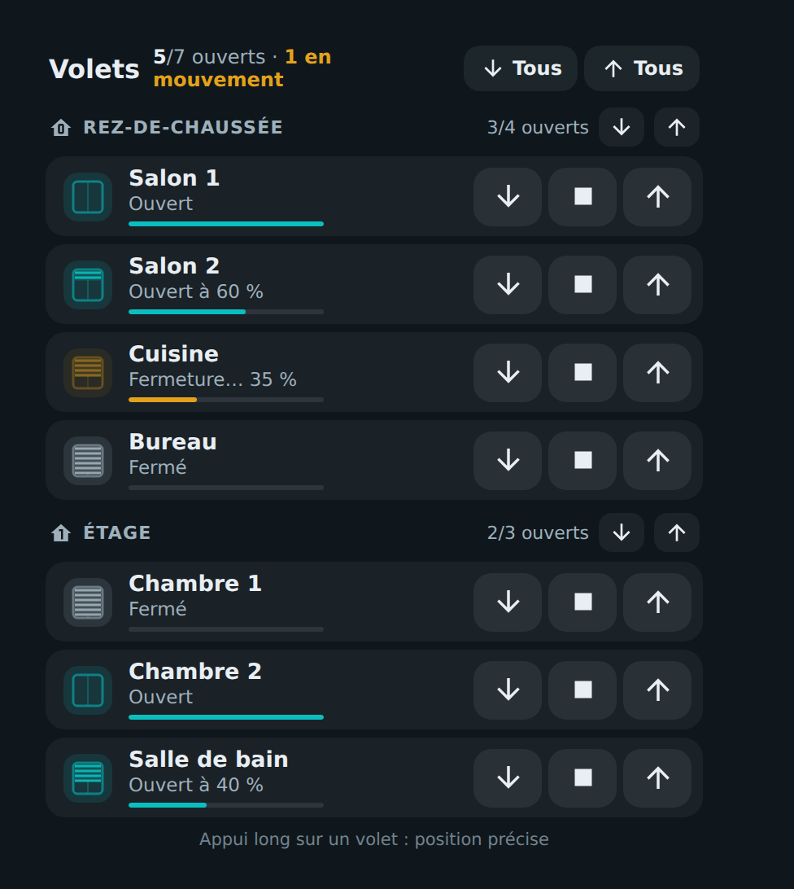
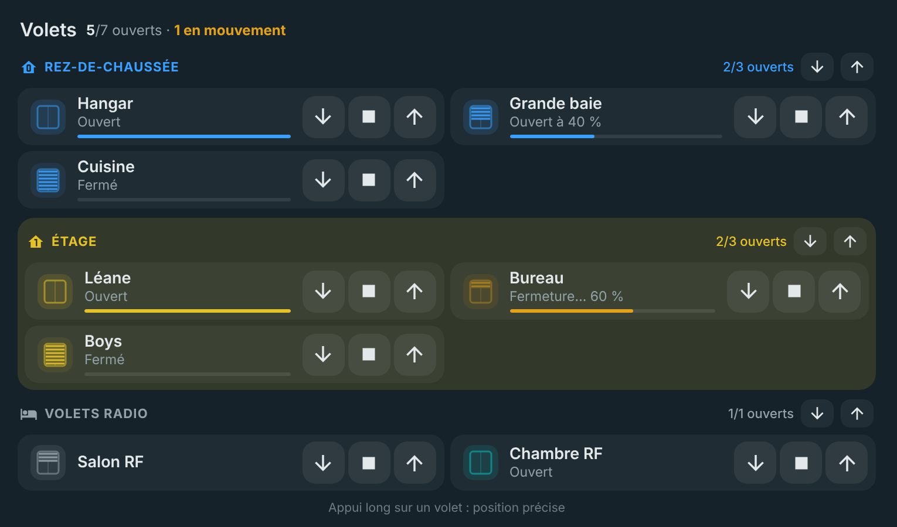
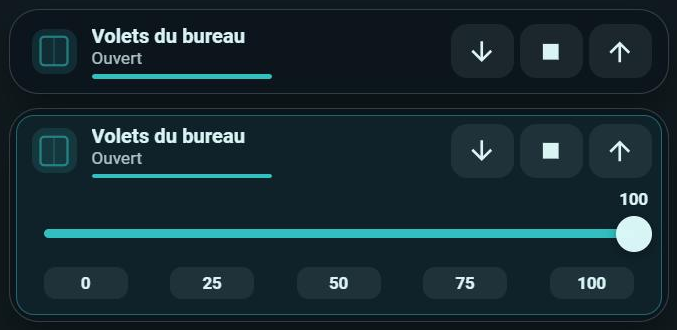
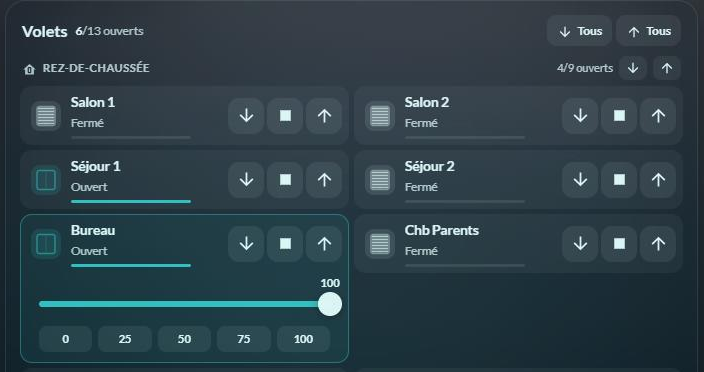

# 🪟 HOLM Covers Card

[](https://hacs.xyz/)


🇫🇷 Français · [🇬🇧 English](README.en.md)

**Tous vos volets sur une seule carte, rangés par étage : un coup d'œil pour savoir ce qui est ouvert, un toucher pour tout commander.**

HOLM Covers Card affiche vos volets roulants de façon **compacte et horizontale**, regroupés par étage (ou par zone), ou **un volet seul** là où vous en avez besoin. Chaque ligne a ses boutons ▼ ■ ▲, sa position en clair (« Ouvert à 60 % », « Fermeture… 35 % ») et une petite fenêtre dont les lames descendent avec le volet.

> ✨ **Zéro YAML.** Groupes et volets se configurent dans l'éditeur visuel.

### En bref

- 🧭 **Résumé** : « 5/7 ouverts · 1 en mouvement », par maison et par étage.
- ⏬ **Commandes groupées** : tout ouvrir / tout fermer par étage, et pour toute la maison avec l'option `all`.
- 🪟 **Volet seul** : une carte d'une seule ligne pour un volet, sans titre ni groupe.
- 👆 **Appui court** sur un volet : ouvre, ferme ou stoppe s'il bouge — ou affiche le curseur, ouvre la fiche, ou ne fait rien (au choix). Faire défiler la page ne déclenche plus rien.
- 🎚️ **Appui long** : curseur de position précise et raccourcis 0 / 25 / 50 / 75 / 100, directement dans la tuile du volet.
- 🟧 Couleur ambre pendant le mouvement, turquoise quand c'est ouvert, jauge de position sous chaque volet (sur toute la largeur).
- 🎨 **Une couleur par groupe** (icônes et titre), fond teinté en option, couleur volet par volet.
- 📡 **Volets sans retour d'état** : état masqué, ou déduit d'un capteur d'ouverture.
- 🛑 **Position la plus fermée** : un volet qui ne doit pas descendre sous 40 % s'arrête à 40 % quand on le « ferme ».
- 🌍 **8 langues** : français, anglais, allemand, espagnol, italien, néerlandais, portugais et polonais.



### 🆕 Nouveautés de la 1.4.0

- 🛑 **Position la plus fermée** (`min_position`, merci à developpeurbox pour l'idée et sa proposition de code) : pour un volet qui ne doit pas descendre en dessous d'une certaine position. Avec `min_position: 40`, le bouton ▼, « Tout fermer », « Tous » et l'appui court s'arrêtent à 40 % au lieu de fermer complètement ; le curseur et les raccourcis ne descendent pas en dessous (zone hachurée, raccourcis grisés). Un volet à sa position la plus fermée s'affiche « Fermé » et ne compte plus comme ouvert. Réglable sur la carte, un groupe ou un volet (le plus précis l'emporte), dans l'éditeur. Voir [Position la plus fermée](#position-la-plus-fermée).
- 🔢 **Masquer les compteurs** (`show_counts: false`) : les « 3/7 ouverts » de l'en-tête et des groupes disparaissent, par exemple quand l'état des volets n'a pas de sens chez vous. « En mouvement » reste affiché.
- La version chargée s'affiche dans la console du navigateur.

### Nouveautés de la 1.3.0

- 🌍 **8 langues** : la carte et son éditeur parlent français, anglais, allemand, espagnol, italien, néerlandais, portugais et polonais. Ils suivent la langue de votre profil Home Assistant (anglais si votre langue n'est pas traduite) ; l'option `language` permet d'en imposer une.

### Nouveautés de la 1.2.0

- 🎨 **Une couleur par groupe** : icônes et titre aux couleurs du groupe, avec un **fond teinté** en option (opacité réglable). Une couleur peut aussi être donnée à un volet précis.
- 📡 **Volets sans retour d'état** (radio…) : masquez « Ouvert / Fermé » et la position (`show_state: false`), ou affichez l'état d'après un **capteur d'ouverture** (`state_entity`, un `binary_sensor`) volet par volet.
- 👆 **Appui court au choix** (`tap_action`) : ouvrir / fermer, curseur de position, fiche du volet ou rien. Un toucher qui glisse (défilement de la page sur mobile) n'est plus pris pour un appui.
- 📏 La **jauge de position** s'étend jusqu'aux boutons.

Tout se règle dans l'éditeur, y compris les **réglages par volet** (nom court, capteur d'ouverture, couleur, état).



### Nouveautés de la 1.1.0

#### 🪟 Un volet seul, sans groupe

La carte peut maintenant afficher **un seul volet**, sans titre, sans en-tête de groupe ni résumé : juste la ligne du volet avec ses boutons ▼ ■ ▲, sa position et sa jauge. Idéal pour mettre les volets d'une pièce sur la vue de cette pièce, à côté de ses lumières.

Dans l'éditeur, choisissez **Affichage → Volet seul**, puis le volet et, si besoin, un nom plus court. L'appui long pour la position précise fonctionne comme dans la carte complète. En repassant à **Groupes de volets**, le volet est repris dans un premier groupe.



#### 🎚️ La position précise reste dans la tuile du volet

À l'appui long, le curseur de position s'ouvre **dans la tuile du volet**, sans déborder sur toute la largeur de la carte : sur deux colonnes, le volet voisin ne bouge pas. Les raccourcis 0 / 25 / 50 / 75 / 100 passent sous le curseur quand la tuile est étroite, et à côté quand elle est large.



---

## Installation

### Avec HACS (recommandé)

1. HACS → menu ⋮ → **Dépôts personnalisés**.
2. Ajoutez `https://github.com/kaaribou/holm-covers-card`, catégorie **Tableau de bord** (*Dashboard / Plugin*).
3. Recherchez la carte → **Télécharger**.
4. Rechargez la page (Ctrl + F5).

### Manuellement

1. Copiez `dist/holm-covers-card.js` dans `config/www/community/holm-covers-card/`.
2. **Paramètres → Tableaux de bord → ⋮ → Ressources → Ajouter** : `/local/community/holm-covers-card/holm-covers-card.js`, type **Module JavaScript**.
3. Rechargez la page.

---

## Utilisation

### Volets par étage

```yaml
type: custom:holm-covers-card
title: Volets
all: cover.tous_les_volets      # optionnel : boutons « Tous »
groups:
  - name: Rez-de-chaussée
    icon: mdi:home-floor-0
    entities:
      - entity: cover.salon
        name: Salon
      - cover.cuisine
  - name: Étage
    icon: mdi:home-floor-1
    entities: [cover.chambre_1, cover.chambre_2]
    color: "#e6c229"              # optionnel : couleur du groupe
    tint: true                    # optionnel : fond teinté
  - name: Volets radio
    entities:
      - entity: cover.salon_rf
        show_state: false         # pas d'état connu : rien n'est affiché
      - entity: cover.chambre_rf
        state_entity: binary_sensor.fenetre_chambre   # état d'après le capteur
```

### Position la plus fermée

Certains volets ne doivent pas descendre complètement : volet IKEA réglé pour laisser passer la lumière, volet qui bute sur un obstacle, chatière… Avec `min_position`, « fermer » veut dire « descendre jusqu'à cette position » :

```yaml
type: custom:holm-covers-card
min_position: 10                  # tous les volets de la carte s'arrêtent à 10 %
groups:
  - name: Étage
    min_position: 20              # les volets de ce groupe s'arrêtent à 20 %
    entities:
      - cover.chambre_1
      - entity: cover.velux
        min_position: 40          # ce volet s'arrête à 40 %
```

- **Ce qui s'arrête à la position réglée** : le bouton ▼ d'un volet, « Tout fermer » d'un groupe, « Tous » ▼ et l'appui court. Avec « Tous », les autres volets du groupe `all` qui ne sont pas affichés dans la carte se ferment normalement.
- **Curseur et raccourcis** : ils ne descendent pas sous la position réglée ; la partie interdite du curseur est hachurée et les raccourcis concernés sont grisés.
- **Affichage** : un volet à sa position la plus fermée (ou en dessous) s'affiche « Fermé », son icône est celle d'un volet fermé et il ne compte plus parmi les volets ouverts.
- **Priorité** : le réglage d'un volet l'emporte sur celui de son groupe, qui l'emporte sur celui de la carte. 0 = fermeture complète, comme avant.
- La limite ne concerne que la carte : vos automatisations et la fiche du volet peuvent toujours le fermer complètement.

### Un volet seul

```yaml
type: custom:holm-covers-card
entity: cover.bureau
name: Volets du bureau          # optionnel
```

## Options

| Option | Description | Par défaut |
|---|---|---|
| `entity` | **Volet seul** : le volet à afficher (remplace `groups`) | — |
| `name` | Volet seul : nom affiché | nom du volet |
| `title` | Titre (mode groupes) | `Volets` |
| `all` | Volet (ou groupe de volets) commandé par les boutons « Tous » (mode groupes) | — |
| `groups` | Groupes : `name`, `icon`, `entities` (entité ou `{ entity, name }`) | — |
| `show_frame` | Afficher le cadre de la carte | `true` |
| `show_state` | Afficher l'état (« Ouvert / Fermé », position, jauge) | `true` |
| `tap_action` | Appui court : `toggle` (ouvrir / fermer / stopper), `position` (curseur), `more-info` (fiche), `none` | `toggle` |
| `show_counts` | Afficher les compteurs « x/y ouverts » (en-tête et groupes) | `true` |
| `min_position` | Position la plus fermée (%) de tous les volets de la carte (voir ci-dessus) | `0` |
| `language` | Langue : `fr`, `en`, `de`, `es`, `it`, `nl`, `pt`, `pl` | celle du profil |
| Groupe : `color`, `tint`, `tint_opacity`, `min_position` | Couleur du groupe (icônes, titre), fond teinté, opacité du fond (%), position la plus fermée du groupe | —, `false`, `12`, — |
| Volet : `name`, `color`, `state_entity`, `show_state`, `min_position` | Nom court, couleur, capteur d'ouverture qui donne l'état, afficher ou non l'état de ce volet, position la plus fermée de ce volet | — |

Il faut soit `entity` (volet seul), soit `groups`. Sans `all`, les boutons « Tous » de l'en-tête ne s'affichent pas ; les boutons de chaque étage restent disponibles.

## FAQ

| Problème | Solution |
|---|---|
| Pas de curseur à l'appui long | Le volet ne gère pas de position (seulement ouvrir / fermer). |
| Mes volets n'indiquent pas leur état | `show_state: false` pour ne rien afficher, ou `state_entity` (capteur d'ouverture) pour chaque volet équipé. |
| L'appui court se déclenche quand je fais défiler la page | Corrigé en 1.2.0 ; vous pouvez aussi choisir **Aucune action** (`tap_action: none`). |
| Mon volet ne doit pas se fermer complètement | `min_position` (ex. `40`) sur le volet, son groupe ou la carte. |
| Les compteurs « ouverts » ne me servent pas | `show_counts: false`. |
| Je veux un volet seul sans le fond de la carte | Décochez **Afficher le cadre de la carte** (`show_frame: false`). |
| La nouvelle version ne s'affiche pas | Videz le cache (Ctrl + F5). |

---

## Un petit merci ?

La carte vous plaît ? Vous pouvez m'offrir une bière 🍺

[](https://paypal.me/kaaribou)

---

## Licence

Code : licence **MIT** — © kaaribou. Voir le [CHANGELOG](CHANGELOG.md).

Fait partie de la collection **HOLM** : [Volets HOLM](https://github.com/kaaribou/volets-holm) · [Climat HOLM](https://github.com/kaaribou/climat-holm) · [Carburant HOLM](https://github.com/kaaribou/carburant-holm) · [Commandes à la maison HOLM](https://github.com/kaaribou/commandes-holm) · [HOLM Navbar Card](https://github.com/kaaribou/holm-navbar-card) · [HOLM Climate Card](https://github.com/kaaribou/climate-card-holm) · [HOLM Music Card](https://github.com/kaaribou/holm-music-card) · [HOLM Sentinel Card](https://github.com/kaaribou/holm-sentinel-card) · [HOLM Security Card](https://github.com/kaaribou/holm-security-card) · [HOLM Recordings Card](https://github.com/kaaribou/holm-recordings-card) · [HOLM Power Flow Card](https://github.com/kaaribou/holm-power-flow-card) · [HOLM Energy Cards](https://github.com/kaaribou/holm-energy-cards) · [HOLM Radiator Card](https://github.com/kaaribou/holm-radiator-card) · [HOLM Floor Card](https://github.com/kaaribou/holm-floor-card) · [HOLM Smoke Card](https://github.com/kaaribou/holm-smoke-card) · [HOLM BG Card](https://github.com/kaaribou/holm-bg-card).
